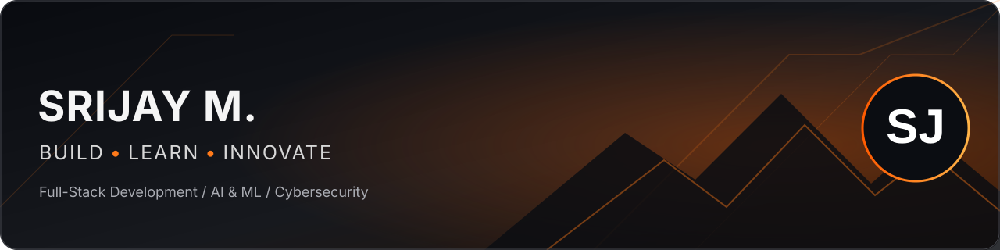

# Srijay M.
### Java Full-Stack Developer | React & Spring Boot | AI/ML Enthusiast
**CSE '28 · Knowledge Institute of Technology**

---

<table>
<tr>
<td width="58%" valign="top">

## 🟠 About

I'm a Computer Science Engineering student at **Knowledge Institute of Technology**, passionate about building intelligent, scalable and secure solutions.

- Full-stack development with Java, Spring Boot, React and MySQL
- Exploring applied AI/ML and practical cybersecurity
- Focused on clean code, software design and hands-on learning

**Focus areas**

</td>
<td width="42%" valign="top">

## 🛠 Tech Stack

**Languages**

**Frameworks & Tools**

</td>
</tr>
</table>

## 🚀 Featured Projects

<table>
<tr>
<td width="50%" valign="top">

### 📍 [PathFinder AI](https://github.com/srijay-2312/PathFinder-AI)
AI-powered personalized learning roadmap platform with Groq-assisted guidance and prerequisite-aware progression.

**React · Java · Spring Boot · MySQL**

</td>
<td width="50%" valign="top">

### 🏛️ [Civic AI](https://github.com/srijay-2312/CIVIC-AI)
AI-focused civic services and governance project.

**React · AI/ML**

</td>
</tr>
<tr>
<td width="50%" valign="top">

### 🏥 [CityCare Hospital System](https://github.com/srijay-2312/CityCare-Hospital-System)
Hospital management system with appointment workflows and an AI assistant.

**Java · JSP · MySQL**

</td>
<td width="50%" valign="top">

### 🛡️ [ShieldAI PC](https://github.com/srijay-2312/ShieldAI-PC)
Offline AI-assisted cybersecurity toolkit with phishing detection and URL analysis.

**Python · AI/ML · ONNX Runtime**

</td>
</tr>
</table>

<a href="https://github.com/srijay-2312?tab=repositories"><b>View all repositories →</b></a>

## 💼 Experience

<table>
<tr><th align="left">Organization</th><th align="left">Role</th><th align="left">Period</th></tr>
<tr><td><b>FirstMatrix Solution</b></td><td>Java Full-Stack Developer Intern</td><td>Jun 2026</td></tr>
<tr><td><b>Cognifyz Technologies</b></td><td>Frontend Developer Intern</td><td>Dec 2025 – Jan 2026</td></tr>
</table>

## 📊 GitHub Statistics

**BUILD · LEARN · INNOVATE**

Obsidian & Ember · Srijay M.

